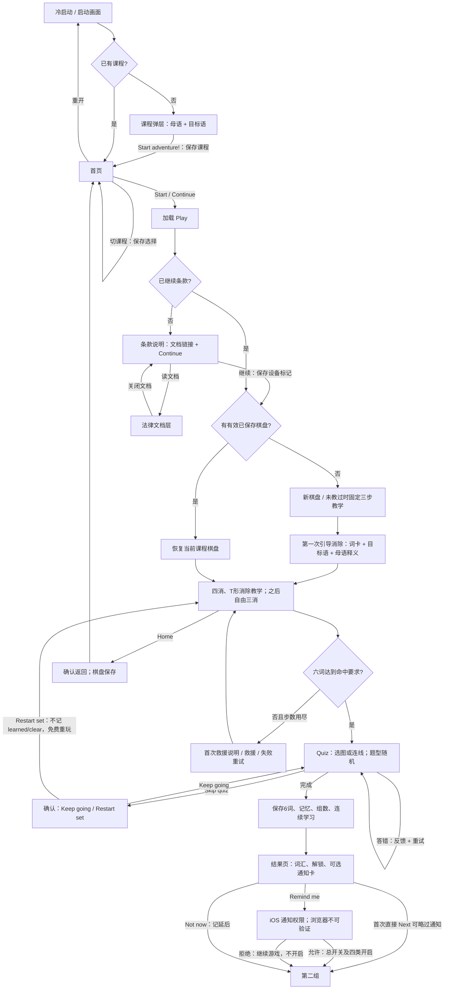
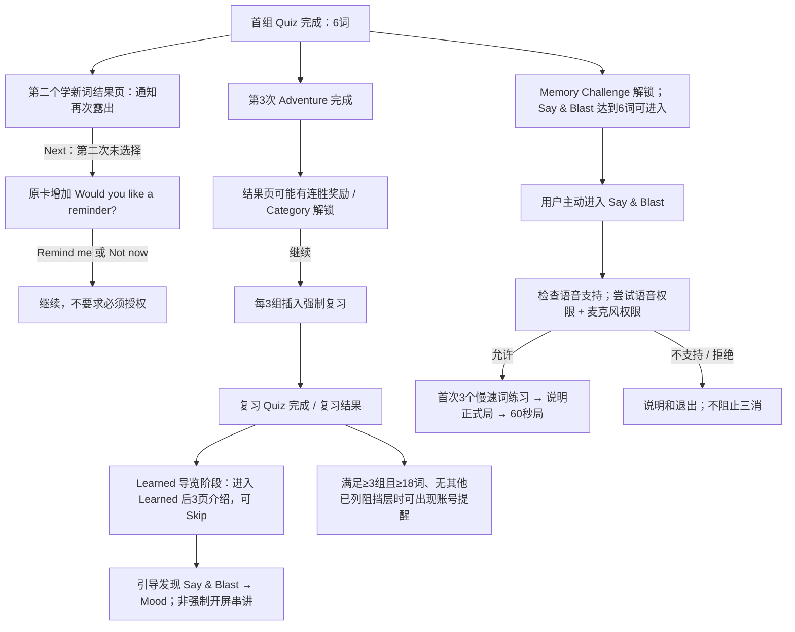

# LingoMatch 首次使用体验审计

审计日期：2026-10-16。对象：本仓库海外 iOS / Web 多语言产品，不涉及独立微信小程序。阶段：研究与方案，未修改产品代码。

## 结论先行

LingoMatch 已经有一条能成立的核心体验：**交换 Emoji → 消除 → 看见并听到目标词 → 再次遇见 → 小测 → 收入词汇集合**。首次进入并没有立即要求注册或通知授权，不能把产品描述成“开屏连续索取权限”。

主要问题不是功能太多，而是几处**动作与承诺不对应、学习成果结算脆弱、以及后半程提示缺乏统一节奏**：

1. 课程页叫“Start adventure!”却不开始游戏；还要在首页再点一次。
2. “Skip quiz”实际是重新玩同一组，不是跳过后继续；三消完成与学习成果入库之间缺少可靠的中断恢复。
3. 精心安排的英语首组没有覆盖西语、日语、韩语，后者会随机起步。
4. 通知已经改成结果页内的小卡片，这是正确的改善；但第二次点击下一组会被卡片截留，和第一次的行为不一致。
5. Say & Blast 在进入模式时就尝试请求语音/麦克风权限，解释练习的页面在授权之后；必要权限的价值解释顺序可以调整。

没有确认 P0 级全局阻断。以下 P1/P2 不等于“必定流失”，用户情绪和转化影响还需要真实新用户研究验证。

## 研究方法与证据边界

本报告使用三种标签：

- **[实测·iOS]**：在新建、独立的 iOS Simulator 安装包上观察。iPhone 17 Pro、iPhone SE 第三代、iPad mini A17 Pro，iOS 26.5。完成原生构建，确认首次课程页、课程确认返回首页、进入游戏后的条款页；小屏和 iPad 首次课程页有原生截图。
- **[实测·Web]**：通过独立浏览器空间操作同一仓库前端，使用专用 `127.0.0.1:5197` 与 `localhost:5197` 测试源。完整走过英文学西语首轮：课程、条款、三步交换教学、三消、六题 Quiz、结果、忽略通知后进入第二组；另测课程切换、刷新恢复、模式入口和设置。375×667、390×844、430×932、768×1024 为浏览器视口，不冒充对应原生设备实测。
- **[代码]**：执行路径、条件、存储键或单元测试确认，未完整验证原生交互。
- **[推断]**：设计研究判断，不是已观察到的普通用户反应。

限制：原生桌面自动化入口因环境路径配置失败；先用隔离模拟器截图和有限前台点击补证，用户继续使用电脑后停止全部前台点击。**未完整实测原生通知 Allow/Don't Allow、语音/麦克风拒绝与恢复、真实发声完成 Say & Blast、真实账号登录与云同步、第三组到强制复习的整段自然旅程。**浏览器明确不支持原生语音识别，不能据此认定 iOS 语音功能失效。发音调用由代码确认，本次未做听音正确性评审，也未把机器操作当作真实用户访谈。

原生使用仓库已经同步的资源（`dist/index.html` 19:37:38、`ios/App/App/public/index.html` 19:37:39），本次没有执行 `cap sync`。前端研究以当前源代码为准；模拟器截图不是 TestFlight 线上构建验证。

相关单元测试 12/12 通过：课程进度隔离、模式棋盘恢复、棋盘目的地身份、目标语言语音 locale。它们不能替代端到端体验测试。

不报告实测秒数：工具等待、研究停顿和用户暂停使本次会话时间不适合作为 TTF 指标。启动配置存在 1800ms 最小展示时间及 280ms 退出动画，但这不是实际启动耗时。

## 八个核心问题的回答

| 问题 | 结论 |
| --- | --- |
| 能否理解产品是什么？ | 首页“Match emoji / Learn Spanish”表达了两部分；首次消除出现双语词卡后关系明确。课程弹层先覆盖首页，且没有展示一次“消除出词”的短示例，理解仍依赖第一次实际操作。[实测、推断] |
| 开始前多少步骤？ | 默认英语→西语：课程确认 → 首页开始 → 条款继续，至少三次提交点击；若更改目标语言再加一次，改母语再加展开及选择。之后才是棋盘教学，不是再读独立教程。[实测] |
| 首次乐趣与价值在哪？ | 第一个引导消除提供视觉反馈；同一次消除弹出目标词和母语释义。是否觉得有趣/学会需用户测试；不必等到 Quiz 才有学习价值。[实测、推断] |
| 提示是否过量？ | 开始前没有注册/通知堆叠。需要研究的是三次提交、固定三步教学，以及第二/第三轮后通知、奖励、强制复习、账号、功能引导的节奏。[实测、代码] |
| 交互是否自然？ | 主要不自然处是双重 Start、Skip 的真实后果、已保存棋盘还要求确认返回首页、同一 Next 在第二次提醒时改变行为。[实测、代码] |
| 登录/隐私/通知时机？ | 登录在≥3组且≥18词之后，不是首局前；通知在成果页较合理。条款不是通知/广告/语音授权的替代。语音解释顺序和 SDK 同意顺序需核对。[代码] |
| 多语言增加选择负担吗？ | 用户不是同时面对24门课；先选使用语言，再见3或4个目标课程。结构可保留。默认母语固定英语、课程确认行为和长文案比“课程数量本身”更值得先改。[实测、代码、推断] |
| 不注册、不通知可以玩吗？ | 可以完成首组并继续，不用注册。第二次提醒仍能选 Not now，属于必须回应而非必须授权。免费体力、强制复习、Say & Blast 必需录音权限是不同限制，不能混为“游客受限”。[实测、代码] |

## 产品结构与状态模型

| 区域 | 实际入口和用途 | 状态与研究注意事项 |
| --- | --- | --- |
| 启动/首页 | BootApp → RuntimeApp → HomePage；背景 Emoji 可点读，Edit Scene、课程入口、Start/Continue | 每次进程重新加载回首页，不保存当前导航页；课程和学习状态另外保存 |
| 课程选择 | 首次强制显示；之后首页或 Me 的课程入口 | 首次无关闭按钮；后续可取消。修改母语草稿立即改变 UI 语言，确认后才提交课程 |
| Play | Adventure 棋盘；模式菜单可进入 Say & Blast，后续 Mood/Category | Adventure 棋盘按课程与用户保存；每日体力跨课程共享 |
| Learned | 词汇记忆状态、复习入口、单词详情 | 首次三页介绍不是开屏必现；由引导状态进入相应阶段才触发 |
| Emojis | 已学词汇集合、分类等 | 词汇收集与“当前已掌握”不是同一概念，不应把一次 Quiz 当作长期掌握证明 |
| Me | 游客/账号、课程、声音/音乐/触感、通知、成就，继续向下有设置/法律信息等 | 通知已是二级设置，不是 Me 首页直接总开关 |
| 账号/Plus/广告 | 用户入口或达到条件后的账号提示；体力分支进入 Plus/激励广告 | 不能把这些页面当成首局必经页面 |
| Quiz/结果/救援/体力不足 | 游戏状态驱动的覆盖层 | Quiz 正确完成后才记录该组 learned/clear；救援在步数用尽、未完成词组时出现 |

关键代码：[启动](</Users/oldmilkmilk/Downloads/🚀Current Projects/match3-vocab-game/src/BootApp.tsx:6>)、[导航](</Users/oldmilkmilk/Downloads/🚀Current Projects/match3-vocab-game/src/App.tsx:37>)、[首页状态](</Users/oldmilkmilk/Downloads/🚀Current Projects/match3-vocab-game/src/components/HomePage.tsx:240>)、[主页面与 Tab](</Users/oldmilkmilk/Downloads/🚀Current Projects/match3-vocab-game/src/components/ItemMatchGamePage.tsx:5229>)。

| 持久化内容 | 隔离范围 | 中断后的含义 |
| --- | --- | --- |
| 课程、使用语言、UI locale | 设备 | 下次不强制重选课程 |
| 条款已继续标记 | 设备，固定布尔值 | 不随课程重复；没有条款版本标记 |
| 已学词、词汇记忆、组数、分类循环、棋盘 | 课程 + 游客/账号 | 日语不会直接继承西语已学词；已付体力棋盘有恢复路径 |
| 首次玩法/功能引导 | 游客/账号；不按课程 | 学过三消后换课程不重教，是合理区别，不是进度串课 |
| Say & Blast 教程完成 | 设备全局 | 完成练习前关闭会再次进入练习；完成后切课程不重教 |
| 体力 | 游客/账号，跨课程 | 切换课程不会免费获得新的3点体力；新自然日补至3 |
| 通知偏好及预提示次数 | 设备 | 不等于 iOS 权限状态；每次调度仍检查系统权限 |
| 账号提示完成状态 | 设备 | 普通账号提示关闭后不再反复；长连学提示按天记住关闭 |
| Quiz 题号/已答题、结果页位置、固定教学子步骤 | 当前组件内存 | 冷重开不能从原位置恢复；详见 P1-02 / P2-04 |

依据：[课程](</Users/oldmilkmilk/Downloads/🚀Current Projects/match3-vocab-game/src/course.tsx:15>)、[进度作用域](</Users/oldmilkmilk/Downloads/🚀Current Projects/match3-vocab-game/src/lib/progressScope.ts:7>)、[首次引导](</Users/oldmilkmilk/Downloads/🚀Current Projects/match3-vocab-game/src/lib/firstTimeGuide.ts:9>)、[体力](</Users/oldmilkmilk/Downloads/🚀Current Projects/match3-vocab-game/src/lib/stamina.ts:112>)、[通知](</Users/oldmilkmilk/Downloads/🚀Current Projects/match3-vocab-game/src/lib/learningNotificationsV2.ts:15>)。

## Report A：真实流程图

箭头表示实际逻辑，不表示每位用户一定走完所有分支。



补充：结果中的通知拒绝后并非一定自动跳下一组；当用户先点 Remind me、没有等待中的继续动作时，会显示状态并保留结果页；仍可 Next。[代码]

首组之后的真实分支：



“第3组后”的奖励、账号和导览不是固定顺序：取决于奖励资格、是否强制复习、进入哪个 Tab、authReady、是否已看过。不能画成每人都会连续弹出的一条链。

## Report B：体验时间线与心理假设

表中“可能感受”均为研究假设，不是假装采访了新用户。

| 阶段 | 用户看到什么 | 必须做什么 / 其他选择 | 可能感受 | UX 判断 |
| --- | --- | --- | --- | --- |
| 冷启动 | 品牌启动画面，随后课程层覆盖首页 | 等加载 | “这是个可爱的游戏” | 有最小展示时间；先量性能，不直接删除品牌动效 |
| 首次课程 | I speak / I want to learn，默认English→Spanish | 默认可直接确认；可选另3/4课程；首次不能关闭 | “我先选学什么” | 决策数量受控；还没看到真实消除示例 |
| 课程确认后 | 同一背景首页、另一颗Start | 再点一次 | “刚才不是开始了吗？” | 确认动作与标签不一致，已实测 |
| 首次条款 | 游客本地保存、Firebase同步说明、文档链接 | Continue；可读文档再返回；无取消游玩入口 | “游戏开始前还要处理一件事” | 有必要信息；是否必须独立阻断需依据合规要求，不直接删除 |
| 教学1/3 | 手势、高亮、Match 3 / uses1move | 指定交换；不能自由操作其他位置 | “照着做就行” | 边玩边学是优点 |
| 第一次消除 | Emoji消除反馈、NEW DISCOVERY、双语词 | 无额外确认点击 | “原来消除会教我词” | 首次学习价值的可观察证据；不等于长期掌握 |
| 教学2/3、3/3 | 四消/T形与步数规则 | 再完成两次指定交换 | “还要多久才能自己玩？”或“这很容易懂” | 两种反应都可能；高级形状可延迟教学 |
| 自由棋盘 | 6个目标词的0/3、Moves/STEP、多个Tab | 完成各词命中；可退出、切Tab、打开模式 | “我在玩，但0/3究竟算次数还是格子？” | 需要一次短小进度反馈，不增加说明弹窗 |
| 第一轮Quiz | 随机选图/连线，含读音与提示 | 正确完成六词；答错重试；Skip实际重玩 | “怎么又进入测验？” | 与三消之间缺少一句轻连接；Skip后果严重不符直觉 |
| 首次结果 | 6词、collection+6、streak、复习解锁、通知卡 | 下一组或收藏；通知可不回应 | “我确实留下了一些词” | 第一轮成果优先；多重统计压缩在同一层 |
| 第二次通知 | 同一卡片；点Next后多一行问题 | 必须明确点Remind me或Not now才能执行原继续动作 | “按钮怎么不像刚才那样工作？” | 非强制授权，但交互规则不一致 |
| 第3组后 | 奖励/解锁；随后强制复习 | 若继续Adventure需先走复习 | “刚熟悉玩法，又换规则” | 是否必要/频率合适是验证课题，不能仅凭推断删除复习 |
| 登录提醒 | 备份已发现词汇；Create、Sign in、Not now | 可以关闭，不需要注册 | “现在我知道账号保存什么了” | 时机比首局前好；最好落在完成态而非新棋盘刚出现 |
| Learned导览 | 三页词汇收藏与记忆状态介绍 | Next/滑动/点圆点，或Skip | “这些词存在这里” | 当前代码已有横滑，不沿用历史截图的旧结论 |
| Say & Blast首次 | 检查支持/权限，随后练习页 | 语音和麦克风是该玩法必需；可退出回三消 | “还没试就要麦克风？” | 应先讲用途，主动开始练习时再请求 |

### TTF：用可复现动作而不是虚构秒数

- **首次可玩**：默认路径3次提交点击后进入教程；变更目标语加1次。选择母语通常另需2次点击，是否另选目标取决于默认选择。
- **首次消除反馈**：再做1次指定交换（一次拖动，或两次点按）。因此默认最短是3次提交 + 1次交换，不是“先完成全部教学才能有反馈”。
- **首次学习价值证据**：第一张匹配词卡；实测出现 `peón de ajedrez / Chess Pawn`。完整首组最终出现六题Quiz与六词结果。
- **首次自由玩**：固定3个交换教学后；可以研究只保留第一交换，让四消/T形自然出现时再提示。
- **首次完整成果结算**：六词达到三次命中要求，加完成六词Quiz。消掉的格子数不能直接换算成学习曝光次数，也不能把工具测试用时当用户完成时长。

## 场景覆盖结果

| 场景 | 已验证 | 仍待原生/真人验证 |
| --- | --- | --- |
| A 完全新用户 | 新模拟器安装及课程/条款；Web完整首组、Quiz、结果、忽略通知继续；Say & Blast入口/不支持态 | 原生整个游戏链、真人第一次理解；原生说话完成；自然达到登录提示 |
| B 谨慎用户 | 首组不用账号；第一通知卡不选也可Next；Quiz退出确认清楚说明会重玩；Say & Blast不支持可Exit | 原生系统拒绝通知/录音后的返回、第二次原生提示；免注册受体力限制后的整个分支 |
| C 回访 | 刷新后课程与6词保留；条款/完成三消教学不重弹；第二组棋盘回到当前课程；部分教学恢复另存截图 | Quiz中断与第二次提醒中断的完整原生复现；断网登录恢复 |
| D 课程切换 | en-es→en-ja→重新打开→en-es；日语显示Start且无西语6词，回西语仍有6词；不重做全局教学 | 任意两种母语/全部24课程、登录后切课、后台云同步竞态 |
| E 尺寸 | 原生SE3/17Pro/iPad mini课程页；Web三种结果页；中文四目标课程小屏内容可滚动 | 原生小屏所有后续弹窗、横屏/分屏、系统大字体、VoiceOver、键盘、全部本地化长文案 |

## Report C：问题优先级与证据

### P0

未确认“无法继续/全局严重阻断”的 P0。语音模式浏览器不支持是测试能力边界，不列为 iOS P0。

### P1-01：Skip quiz 的含义与结果不一致

- 页面/条件：任意组完成三消后进入Quiz，点击Skip quiz。
- 证据：[实测·Web]出现“Abandon this quiz?”，正文说明这组重来；[代码]确认后 `handleQuizAbandon` 不记 learned/clear，调用免费同组重玩。不是继续下一组。截图 `web-06-skip-warning.png`。
- 位置：[Quiz退出](</Users/oldmilkmilk/Downloads/🚀Current Projects/match3-vocab-game/src/components/mobile/RoundQuizSheet.tsx:351>)、[重玩逻辑](</Users/oldmilkmilk/Downloads/🚀Current Projects/match3-vocab-game/src/components/ItemMatchGamePage.tsx:3604>)。
- 影响假设：谨慎型用户把Skip当快速继续，反而重复劳动，对“有没有学到/保存”失去信任。
- 建议：短期只改为 `Restart set` 或 `Leave quiz` 并保持后果说明；若产品真正提供Skip，必须明确保存为“已遇见/待复习”，不能虚增“已掌握”，也不能暗中重玩。后者是产品决策，不在本阶段实施。
- 验收：任意退出按钮与实际目的地一致；Skip/Leave不得与“保存进度”相混淆。

### P1-02：Quiz 中断不能恢复，三消成果处于未结算空档

- 页面/条件：完成六词三消后，Quiz未完成时进程重载/关闭。
- 证据：[代码]开始Quiz时清除Adventure快照；Quiz题号和答案只在组件内存；完整Quiz后才写 learned/clear。不是“手机切后台一定丢失”，而是WebView/进程重建时没有持久化恢复路径。本次未执行该分支的完整原生杀进程复现。
- 位置：[快照清除](</Users/oldmilkmilk/Downloads/🚀Current Projects/match3-vocab-game/src/components/ItemMatchGamePage.tsx:1731>)、[Quiz内存状态](</Users/oldmilkmilk/Downloads/🚀Current Projects/match3-vocab-game/src/components/mobile/RoundQuizSheet.tsx:80>)、[结算入库](</Users/oldmilkmilk/Downloads/🚀Current Projects/match3-vocab-game/src/components/ItemMatchGamePage.tsx:3202>)。
- 建议：保存“棋盘已完成、待测验”检查点，按课程/用户保存题型、题序、已答与错误记录；重开明确 `Finish your quick check`。体力不再扣，已答结果不重置。
- 验收：在Quiz第1/3/6题前后杀进程，各课程均可恢复，不丢三消成果、不重复扣体力、不重复结算。

### P1-03：英语的固定首组选词未覆盖其他目标语

- 页面/条件：没有已学词的首组Adventure，目标语非英语。
- 证据：[代码]固定首组通过 `item.word === 'Safety Pin'` 等英文字符串找词；目标词已本地化时不能匹配，退回随机。[实测·Web]西语首组出现Chess Pawn、Wedding、混淆/担忧表情；首次未接受条款时的临时棋盘甚至出现长词 `mujer dando una voltereta lateral`。后者不是接受后必定出现的教学首组，不混淆两者。
- 位置：[首组选词](</Users/oldmilkmilk/Downloads/🚀Current Projects/match3-vocab-game/src/components/ItemMatchGamePage.tsx:464>)。
- 建议：以稳定词条ID定义首组；按课程校验可用性、读音和语义。挑选视觉好认、双语关系清楚、长度适合屏幕的词，不简单把所有课程翻成同一串英文文字比较。
- 验收：四目标语×不同母语的首次6词可预测；词卡不截断；词音和母语解释一致；第一次交换后能说清“消除会发现词”。

### P1-04（需核对）：自定义条款展示与实际 SDK / analytics 顺序不一致

- 页面/条件：全新安装，确认课程在前，条款在进入游戏后。
- 证据：[代码]AppDelegate启动就配置Firebase；确认课程会调用原生 `course_selected`，该调用不读取法律Continue标记。条款说明主要讲“选择登录后发送账号与进度”，不是analytics的独立说明。**没有网络抓包证明实际传输了哪些数据，本报告不据此宣判违规。**
- 位置：[原生启动](</Users/oldmilkmilk/Downloads/🚀Current Projects/match3-vocab-game/ios/App/App/AppDelegate.swift:13>)、[课程事件](</Users/oldmilkmilk/Downloads/🚀Current Projects/match3-vocab-game/src/course.tsx:88>)、[analytics桥](</Users/oldmilkmilk/Downloads/🚀Current Projects/match3-vocab-game/src/lib/coreAnalytics.ts:9>)、[条款说明](</Users/oldmilkmilk/Downloads/🚀Current Projects/match3-vocab-game/src/i18n/locales/en.ts:315>)。
- 建议：核对SDK实际采集、配置、目标地区与隐私政策；必要同意在对应采集前完成。不要只把法律弹窗缩小/移走，却保留错误的数据时序。区分条款接受、隐私告知、可选analytics、广告UMP、iOS权限。
- 验收：首次同意前/后抓包与事件日志；拒绝可选数据授权仍可玩；文案、政策、App Store隐私声明与实际一致。Apple要求数据用途说明与必要同意，不能用游戏体验为理由省略。[Apple 5.1.1](https://developer.apple.com/app-store/review/guidelines/#privacy)

### P2-01：双重 Start 与默认母语

- 条件/证据：[实测·iOS/Web]课程确认后回首页再开始；[代码]默认source固定en，UI语言另由系统检测，因此系统非英语时可能“本地UI + 默认I speak English”，未做对应原生设备语言实测。
- 位置：[确认只保存课程](</Users/oldmilkmilk/Downloads/🚀Current Projects/match3-vocab-game/src/components/mobile/CoursePickerSheet.tsx:162>)、[首页回调](</Users/oldmilkmilk/Downloads/🚀Current Projects/match3-vocab-game/src/components/HomePage.tsx:798>)、[默认语言](</Users/oldmilkmilk/Downloads/🚀Current Projects/match3-vocab-game/src/course.tsx:44>)。
- 建议：首次确认直接开始已选课程；后续切课按钮叫 `Use this course`。使用系统语言作可编辑母语预填，不把它当已确认选择。

### P2-02：第二次通知把“下一组”变成隐形的选择关卡

- 条件/证据：[实测·Web]第一次结果直接Next可继续；[代码]记录第2次view后，Next被 `continueWith` 拦截，加问题并聚焦Remind me；Not now可继续，因此不是强制允许通知。拒绝预提示后冷却7天。
- 位置：[卡片拦截](</Users/oldmilkmilk/Downloads/🚀Current Projects/match3-vocab-game/src/components/mobile/LearningReminderCard.tsx:50>)、[结果动作统一包装](</Users/oldmilkmilk/Downloads/🚀Current Projects/match3-vocab-game/src/components/mobile/RoundResultSheet.tsx:83>)。
- 建议：保留用户偏好的小卡与Remind me轻发光，但不改变Next含义；第二次可更明确问一句，仍不截留主流程。若坚持必须回应，必须做成明确、可选Not now的独立问题状态，不能先让Next看起来已经可直接进入下一组。
- 验收：任何拒绝都可继续；没有系统权限请求自动弹出；短时最多一次沟通；新内容范围清楚可见且可关闭。一次选择可以包含明确展示的多类通知，不等于系统Allow自动同意所有营销用途。[Apple 4.5.4](https://developer.apple.com/app-store/review/guidelines/#apple-sites-and-services)

### P2-03：第二次提醒中断后可能失去后续自动邀请

- 条件/证据：[代码]view在展示时立即+1，第二次未选择便关闭App，views=2且无deferredAt。`shouldOffer`要求views<2；没有后续延期计时。体力不足与Me入口仍存在，不是完全无法开启通知。本次未完成此分支UI复现。
- 位置：[计数和7日规则](</Users/oldmilkmilk/Downloads/🚀Current Projects/match3-vocab-game/src/lib/learningNotificationsV2.ts:352>)、[挂载计数](</Users/oldmilkmilk/Downloads/🚀Current Projects/match3-vocab-game/src/components/mobile/LearningReminderCard.tsx:47>)。
- 建议：持久化 `shown / accepted / deferred / interrupted`，显示次数不等于决定次数；中断不算拒绝，也不马上追问，下次合适成果节点再考虑。

### P2-04：首次教学中断后的子阶段和首页“继续”语义需补齐

- 条件/证据：[实测·Web]中文学英语，第一次交换后界面为“2/3，连成4个”；刷新并重新进游戏后，原棋盘、19步、Beaver的1/3命中保留，条款不重现，但教学变回“连成3个”，原2/3阶段没有恢复。首次HUD的3/3为进入时保留展示，重开显示真实2/3体力，不是又扣了一点。[代码]固定three/four/cross只在内存，完成整个三步才持久化已教标记；棋盘快照没有教学stage。首页主按钮只按clears是否为0决定Start/Continue，首组中途退出仍可能显示Start。已完成教学后换课不重教则是合理行为，别一并改掉。
- 位置：[教程子状态](</Users/oldmilkmilk/Downloads/🚀Current Projects/match3-vocab-game/src/components/ItemMatchGamePage.tsx:1550>)、[快照恢复](</Users/oldmilkmilk/Downloads/🚀Current Projects/match3-vocab-game/src/components/ItemMatchGamePage.tsx:1664>)、[首页标签](</Users/oldmilkmilk/Downloads/🚀Current Projects/match3-vocab-game/src/components/HomePage.tsx:327>)。
- 建议：保存教学阶段或重开时可靠地转换为自然棋盘引导；有当前棋盘就显示Continue。不要为了恢复教学而重新扣体力或换一组词。

### P2-05：Say & Blast 先申请权限，再解释练习

- 条件/证据：[代码]组件mount注册监听后自动 `authorizeAndStart`；原生先speech authorization，再microphone；允许后才展示Quick Voice Practice。[实测·Web]不支持状态能退出，未验证原生两次弹窗。
- 位置：[自动请求](</Users/oldmilkmilk/Downloads/🚀Current Projects/match3-vocab-game/src/components/mobile/SayBlastGame.tsx:1389>)、[请求流程](</Users/oldmilkmilk/Downloads/🚀Current Projects/match3-vocab-game/src/components/mobile/SayBlastGame.tsx:1350>)、[Swift](</Users/oldmilkmilk/Downloads/🚀Current Projects/match3-vocab-game/ios/App/App/AppleSpeechRecognitionPlugin.swift:41>)。
- 建议：先展示玩法价值与“需要麦克风识别你读的词”，用户点Start practice再请求；拒绝后可返回普通三消。是否提供无麦克风演示是新产品决策，不列为必须开发。

### P2-06：已自动保存仍确认“返回首页”；后半程没有统一提示调度

- 条件/证据：[实测·Web]点击Home出现Return Home确认，正文说棋盘已保存；[代码]账号有阻挡条件，但Learned导览、通知计数、语音教程、奖励各自控制。不是证实发生“两个弹窗同时叠在一起”。
- 位置：[Home确认](</Users/oldmilkmilk/Downloads/🚀Current Projects/match3-vocab-game/src/components/mobile/GamePanel.tsx:1082>)、[账号阻挡列表](</Users/oldmilkmilk/Downloads/🚀Current Projects/match3-vocab-game/src/components/ItemMatchGamePage.tsx:4826>)、[Learned导览](</Users/oldmilkmilk/Downloads/🚀Current Projects/match3-vocab-game/src/components/mobile/LearnedPanel.tsx:313>)。
- 建议：没有未保存/不可逆后果时直接回首页，显示短Saved反馈；建立统一沟通队列，必要权限/玩法恢复优先，成果之后一次只提出一个非必要请求。完成强制复习的同一停顿不再排账号+功能教学。

### P2-07：第一局同时强教四消与T形，后续强制复习恰与体力节点接近

- 条件/证据：[代码、实测·Web]第一局必须完成three/four/cross才能自由玩；每3组插强制复习，免费每日初始3体力，账号阈值也是3组18词。尚未实测第三组后的整条原生链。
- 位置：[固定手势](</Users/oldmilkmilk/Downloads/🚀Current Projects/match3-vocab-game/src/components/ItemMatchGamePage.tsx:238>)、[完成阶段](</Users/oldmilkmilk/Downloads/🚀Current Projects/match3-vocab-game/src/components/ItemMatchGamePage.tsx:4594>)、[三组复习](</Users/oldmilkmilk/Downloads/🚀Current Projects/match3-vocab-game/src/lib/adventureRules.ts:1>)、[体力](</Users/oldmilkmilk/Downloads/🚀Current Projects/match3-vocab-game/src/lib/stamina.ts:7>)。
- 建议：[推断]先教一次交换，四消/T形在玩家遇到机会时教；先保留复习机制，但用真实数据研究第三组后提示量、完成率与体力恢复路径，不能同时凭感觉删掉学习机制和商业限制。

### P3-01：信息层级与点击目标有具体改进空间

- [实测·Web]375×667结果页没有横向溢出，Next可见；Remind me/Not now仅36px高，收藏链接仅16px高；解释和范围文字10–11px。原生大字体尚未验证。
- [实测·Web]Say & Blast“不支持识别”时顶栏仍写Listening…；代码除了requesting，其余permissionPhase都显示同一个listening文案，形成状态矛盾。
- 位置：[通知样式](</Users/oldmilkmilk/Downloads/🚀Current Projects/match3-vocab-game/src/components/mobile/LearningReminderCard.tsx:81>)、[结果收藏动作](</Users/oldmilkmilk/Downloads/🚀Current Projects/match3-vocab-game/src/components/mobile/RoundResultSheet.tsx:369>)、[语音状态标题](</Users/oldmilkmilk/Downloads/🚀Current Projects/match3-vocab-game/src/components/mobile/SayBlastGame.tsx:1737>)。
- 建议：轻量不等于微小文字；可点区域扩到约44pt级，主次色彩保持，但不让拒绝按钮难点。权限未准备好时写Mic off / Not available，真正识别开启才写Listening。

## 统一用户沟通系统：触发与关闭清单

| 提示 | 触发与必要性 | 阻断/拒绝与重复 | 更自然的替代 |
| --- | --- | --- | --- |
| 首次课程层 | 没有有效保存课程；必须知道学习方向 | 首次不能取消；确认后不再强制；后续切课可取消 | 保留两层选择；确认直接玩；切课强调保留各自进度 |
| 条款页与法律文档 | 进入Game且设备未Continue | 单Continue，无退出；文档可关闭回原层；不按版本重现 | 保留必要实质，压缩账号技术解释，采集顺序先核对 |
| 交换/四消/T教学 | 新玩法用户、首课程首局；其他交换被限制 | 没有Skip；完成后保存全局已教标记 | 第一交换必须，后续组合渐进提示 |
| NEW DISCOVERY词卡 | 消除命中目标；读音/词卡队列 | 自动消失，无同意动作；串行发音，非权限层 | 保留，这是产品核心，不算需要删的“弹窗” |
| 8秒无操作手势提示 | 普通棋盘停顿，无首交换教学等 | 不要求决定；行动后重置 | 保留辅助，勿与权限请求一起亮 |
| 复习/救援教学 | 首次复习或步数失败救援 | 引导操作/阶段确认；已教状态有保存 | 失败不连着加入通知/账号请求 |
| Quiz答错反馈/释义 | 选错/主动点Show meaning | 可重试；不是全局授权阻断 | 保留即时学习反馈，避免惩罚口吻 |
| Quiz退出确认 | 点击Skip quiz | Keep going或重玩；重玩不计学习完成 | 先改入口名字，后决定是否真实跳过 |
| 奖励领取/结果 | 达到奖励阈值或Quiz完成 | 奖励可能先于总结；首组实际未出现奖章领取层 | 奖励不应遮住第一份学习成果；重复奖章可后置 |
| 通知预提示 | 学新词结果；未开通知；未达展示上限/已过延期7天 | 第一次可忽略；第二次拦Next要求明确回答；Not now延7天 | 保留卡片和价值表达；不劫持主动作；显示≠已决定 |
| iOS通知权限 | 点击Remind me/设置开启/体力提醒 | 允许后四类开启；拒绝仍可玩；系统拒绝不是每次能再弹 | 拒绝后在主动设置入口给系统设置路径，不追着索权 |
| 体力不足 | 无体力继续新棋盘 | 可转复习、Say & Blast、广告/Plus或回首页，按资格显示；提醒是可选按钮 | 此处只解释当前体力与可走路径，不再叠另一通知弹层 |
| 普通账号提醒 | auth可用、游客、≥3组且≥18词、无列出的阻挡层、未处理普通提醒 | 可X/背景/Not now；处理后不再普通提醒 | 完成态小卡说明备份；不在新棋盘刚出现时索取账号 |
| 长期连续学习账号提醒 | 达到7日长连学门槛/第6日次日 | 可继续不保长连学；关闭当天不重复 | 与数据备份分清，不把“登录”说成三消必要条件 |
| Learned三页导览 | 首次强制复习完成后进入引导阶段并进该Tab | Skip、Next、圆点、横滑；完成后不重来 | 首页只指出“词保存在这里”；更深记忆规则按需 |
| 功能手势指引 | Learned→Say & Blast→Mood等stage，prompt各最多2次 | 非独立长说明；有已访问/已播放标记 | 自主发现即退出指引，不叠账号或营销 |
| 语音/麦克风系统权限 | 进入Say & Blast且原生能力可用 | 当前自动请求；拒绝有退出/重试，三消不依赖该权限 | 先解释，再主动Start practice请求 |
| 激励广告UMP | 用户选择看广告，生产广告流程检查 | 与自定义条款无关；地区/SDK决定表单；不可省略必要同意 | 保持在主动看广告节点；不要挪到首局前 |
| 评分/Plus/登录详细页 | 相应体验门槛或主动功能入口 | 不在本次首组实测中出现；不能计入每人开局步骤数 | 统一队列与冷却，商业请求不抢学习成果 |

清单只统计已接到运行路径的提示；仓库中旧 `LearningReminderPromptSheet.tsx` 无运行引用，不能因为文件存在就计为第二个现用通知弹窗。通知当前使用V2，不用旧V1的规则代替。

## 隐私与通知：必须分开处理的事实

1. 条款/隐私说明是产品层；通知Allow、麦克风、语音识别是系统能力；广告UMP是广告SDK合规流程。不能把一个Continue理解成全部权限。
2. 通知一次明确选择可以开启已展示的多类内容；当前范围写明学习提醒、新课程、特别活动，允许后四类偏好全部开。**新内容偏好不等于已接入远程推送**：目前调度的是本地复习/连续学习/体力，设置中明确coming soon。后端活动发送仍是未来独立能力。
3. 总开关、分类开关、系统权限应能区分；不要为提高同意率藏掉关闭入口。Apple要求营销通知明确同意并提供应用内退出方式。[Apple通知设计](https://developer.apple.com/design/human-interface-guidelines/managing-notifications)
4. 首次当天已玩时，默认19:30提醒排到下一天；体力按自然日补充，提醒排到恢复日09:00，不是午夜叫用户回来。[代码]本次没有实际收取通知，不能据此评价送达成功率。
5. 复习数量在调度时计算，30日排程不是实时后台课程服务。后续需验证多课切换、系统撤权、时区变化、长期不打开后的准确性；本次不扩展开发推送后台。

## Report D：建议的新用户流程

### 目标流程

```text
冷启动
  → 简洁课程选择：母语预填但可改，3/4目标语
  → 必要条款/隐私环节（数据采集前；内容经合规核对）
  → 一次“开始”：直接落在已选课程棋盘
  → 一次引导交换
  → 真消除 + 双语词卡 + 发音
  → 自由玩；需要四消/T形时才给操作提示
  → “See what stuck”轻连接
  → Quiz（能恢复；退出后果明确）
  → 六词成果：先获得成就感，再可选提醒
  → 下一组 / 看我的词，自由选择
```

这里不是要求新增独立过场：连接可以是Quiz标题或一句短文案，不再加一个“继续”弹窗。

| 处理 | 保留/变化 |
| --- | --- |
| 保留 | 课程选择、必要合规、真实交换教学、词卡/发音、Quiz学习作用、成果、游客体验 |
| 删除冗余 | 第二个Start提交；无不可逆风险时的Home确认；重复赞扬和重复长说明，不删除核心词卡 |
| 合并 | 通知价值表达放成果卡中，不再另开巨大的全屏预提示；课程确认与真正开始衔接 |
| 延迟 | 四消/T形、详细记忆盾牌解释、账号备份提示、商业提示；不延迟依法必须在采集前的同意 |
| 非阻断 | 通知邀请、已保存反馈、模式解锁、后续功能指引 |
| 真实操作教 | 交换、一次消除出词、词条进度变化；Say & Blast先慢速实操，不一次读完60秒和星级规则 |
| 回访 | 先恢复当前检查点；课程/条款/已完成教程不重问；未答权限不追弹；界面上明确“继续这组” |
| 换课 | 选择页一句“每门课单独保存进度”；确认后课程名/词音/词义同时更新，体力跨课程规则在需要时解释 |

第三组后的建议节奏：完成成果 → 由一个主要动作进入复习 → 完成复习成果 → 允许休息/自由选择。账号备份邀请和Learned导览不要同时抢这个停顿。**保留学习复习机制，先用研究验证频率，不把“游戏化”理解成取消学习。**

## Report E：关键页面与弹窗设计方案

以下是规格建议，不是已经修改好的界面。

### E1 课程页：轻、明确、真正开始

- 标题：`What would you like to learn?`；母语行 `I speak · English`，点击修改。
- 目标课程保留现有国旗、圆润卡片和小场景图；默认3/4张，不新增长列表、测试或目标问卷。
- 首次主按钮：`Let’s play`（直接进入所选课程的必要后续环节）；换课按钮：`Use this course`。
- 一句低强调信息：`Switch anytime. Each course keeps its own progress.`
- 手机保留底部面板和固定主按钮、内容区滚动；iPad居中限宽。以真实内容高度为准，不硬塞进固定小高度；正文可减少，不能缩成难读小字。
- 回访直接用上次课程；取消换课恢复原语言和课程；不重播课程教学。

### E2 合规说明：少讲内部系统，多讲真实数据

- 保留必要说明与法律链接；不要装扮成奖励弹窗，也不强加巨大Emoji。
- 信息次序：可以先以游客试玩 → 哪些数据如何处理 → 条款/隐私入口 → 清楚的继续/同意动作。
- 把Firebase技术名与详细账号流程放在可展开说明/政策中；但如果analytics实际发生，主说明不能暗示游客完全没有数据发送。
- 是否可与开始动作合并、是否需要拒绝可选采集，先由实际SDK与地区要求确定，不能只以“少一次点击”决定。
- 增加长文滚动、大字体与文档返回测试；按钮44pt级。条款版本变化时采用明确版本策略，不依赖永久1布尔值。

### E3 棋盘教学：第一消除就是说明

- 保留真实棋盘、高亮两格和轻手势；第一句只说 `Swap to match 3`。
- 消除后保留目标词大字、母语小字、真实读音；用小进度变化表达“再遇到会更熟悉”。
- 四消/T形在首次机会出现时才提示；避免把玩家自由操作限定到三段课程结束。
- 如果保留三步教学，提供清楚的Skip basics，且跳过后棋盘仍可完成；不要让拒绝高级教学导致无解局。
- 重开恢复已完成动作，不重开首个教学棋盘、不换词、不扣第二点体力。

### E4 Quiz与成果：别让完成一局变成没完成

- Quiz一句连接：`You’ve met these words. See what sticks.`；沿用现有可爱配色、Emoji选项。
- 词音、Show meaning、选项为主；Previous/Next只在真实可用时强调。退出叫Leave/Restart，不叫虚假的Skip。
- 退出确认只有在会损失/重置时出现；如已有检查点，允许 `Save & leave`，再次进入接续原题。
- 成果第一层：`6 new words discovered!`＋真实六词；第二层：一个进展信息；解锁用窄条，不再抢标题。
- 主按钮Next set约44–52pt高；收藏次动作仍需可点面积，不能只有16px字高。小屏长词适度换行，不缩成密集小字。
- 永远先保存，再展示庆祝；杀进程不会抹去已完成棋盘。

### E5 通知卡：留住进步，而不是让人处理设置

- 已有结果标题时不再重复第二个大“6词”标题；用 `Let’s keep it going.`。
- 正文：`A minute a day is a little progress. Let me remind you to keep it going.`
- 范围：`Learning reminders, new courses & special events.` 保持可见可读；不能为美观隐藏营销范围。
- 两个明确动作：Remind me、Not now。主游戏按钮Next独立、不失效；允许继续玩而不回应。
- 沿用浅蓝小卡和圆角、少量铃铛；Remind me只做温和光晕，建议最多几个周期，尊重Reduce Motion；不是整卡强闪。
- 系统请求只在主动Remind me后。拒绝后卡片收起并记录冷却；后续可在体力不足或用户主动Me设置中开启，不紧接着再问。
- 对后台中断保存“未决定”，不要把曝光2次当永不再问；系统已拒绝时不要伪装还能弹Allow。

### E6 Say & Blast：先明白为什么要说话

- 首屏保留游戏场景，不先压暗为权限向导：`Say it. Blast it.`＋一个正在掉落的词示例。
- 一句用途：`Use your voice to practise the words you’ve discovered.`；按钮Start practice，次动作Not now/关闭。
- 点击练习时再解释/申请所需权限；如果已授权则直接3个慢速实操。
- 拒绝页：Mic off + Open Settings（仅当系统确需设置）+ Back to playing；不把网络、不支持、拒绝混用同一句“检查网络”。
- 实际识别工作才显示Listening；不支持与未授权不显示假活跃状态。再次打开记住教学完成状态，但按系统当前权限决定路径。

## Report F：分阶段实施计划

**本阶段到报告为止，以下全部待用户确认。不要一次重做整个App。**

### 第一批：先交付五个小范围任务

| 顺序 | 独立任务 | 验收与暂停点 |
| --- | --- | --- |
| 1 | Quiz退出语义与检查点恢复（P1-01/02） | 先确认“真实跳过”还是“保存退出”；第1/3/6题杀进程恢复，体力与结算幂等。完成后单独体验再继续 |
| 2 | 所有课程的固定首组选词（P1-03） | 改用稳定ID；四目标语均检查文字、音频和可辨识度，不批量重做音频。让用户看首组名单后定稿 |
| 3 | 课程确认真正开始（P2-01） | 首次只一次开始，后续切课不误开局；母语预填可改；原进度保留。确认用户路径后再动代码 |
| 4 | 通知邀请节奏与状态（P2-02/03） | 明确决定第二次是否仍需回应；Next含义固定；冷却/中断/系统拒绝测试；不新建远程推送后台 |
| 5 | 必要权限顺序核对（P1-04/P2-05） | 先核对数据采集，再决定条款与analytics；Say & Blast主动开始后请求录音权限。真机拒绝/允许/系统撤权验证 |

### 第二批：确认第一批后再做

- 渐进教学：只强教第一次交换；四消/T形在合适机会出现，保留已完成教学标记。
- 第三组后的节奏：成果、强制复习、账号、Learned导览/模式引导统一排队；先记录并验证，不一口气砍掉机制。
- Home直接返回与Continue标签；结果页可点面积、长词与状态文案修整。

### 发布前回归清单

1. 原生新装/升级各一轮；两种母语×四种目标语覆盖，课程之间不串词、不串音、不串进度。
2. 短时切后台与杀进程分开测试；在教学、词卡、Quiz、结果、提醒选择、救援中断。
3. 通知：预提示忽略/拒绝、系统拒绝、允许、系统撤权、App内单类关闭、跨时区和隔日排程；确认实际收到一次测试通知。不能只看开关是On。
4. 语音：允许/拒绝/不支持locale/无网/中途来电或后台；取消后仍可三消，不出现Listening假状态。
5. SE级小屏、典型大屏、iPad；大字体、Reduce Motion、VoiceOver、法律文档返回、弹层焦点与滚动锁。
6. 第三组完整链：强制复习、奖励、0体力、账号阈值同日碰在一起时，至少有清楚的继续/休息路径，不能连续三个非必要请求。

### 真人研究与衡量

招募5–8位没见过App的探索性测试者，覆盖不想注册/不愿授权、非英语目标语用户。无提示试玩，再问“这个游戏怎么帮你学词？”；样本只作发现问题，不宣称统计代表性。

记录：开始前提交次数；首次合法交换/首次词卡/自由操作/首组完成的时间；课程确认后停顿；Quiz误退出与放弃率；每会话阻断提示数；拒绝权限后继续成功率；中断恢复成功率。通知同意率是辅助指标，不是唯一成功指标。

当前六类核心analytics没有覆盖上述全部过程；是否新增研究事件需先完成隐私与同意核对。**本次没有添加任何埋点。**

## 截图索引与复现

所有截图是本次测试产物，不是重新绘制的营销图。截图目录与报告同级 `evidence`。

- `native-01-first-launch.png`：17 Pro全新首次课程层。
- `native-02-after-course.png`：确认课程后仍在首页，可见另一Start。
- `native-03-consent.png`：进入游戏后条款页，不是iOS系统权限。
- `native-04-small-course.png`：SE3首课选择与开始按钮。
- `native-05-ipad-course.png`：iPad mini居中课程层。
- `web-01-course.png`、`web-02-consent.png`、`web-03-tutorial.png`：当前源代码的首次入口。
- `web-04-after-first-match.png`：第一次词卡/下一教学阶段；视具体捕获时刻，文字变化以浏览器操作记录与代码为准。
- `web-05-quiz.png`、`web-06-skip-warning.png`：首个选图Quiz与Skip真实后果。
- `web-07-result-small.png` / `large.png` / `ipad.png`：同一真实结果状态的三个Web视口。
- `web-08-sayblast-unsupported.png`：浏览器不支持原生语音，且顶栏仍写Listening的状态矛盾。
- `web-09-zh-course-small.png`：中文母语四目标课程，小屏内容区需滚动但主按钮固定。
- `web-10-mid-tutorial-resume.png`：中文学英语，原四消2/3阶段刷新后变回三消提示；棋盘与19步保留。

原生构建命令：`xcodebuild -project ios/App/App.xcodeproj -scheme App -configuration Debug -sdk iphonesimulator -derivedDataPath /private/tmp/lingomatch-ftue-derived CODE_SIGNING_ALLOWED=NO build`，结果BUILD SUCCEEDED。

测试模拟器均为本次新建，未抹除用户原有模拟器数据。前台测试已停止；测试结束关闭本次模拟器运行，保留安装数据可复查。

**交付到此停止。下一步应由用户选择第一批任务，而不是自动开始实施。**
